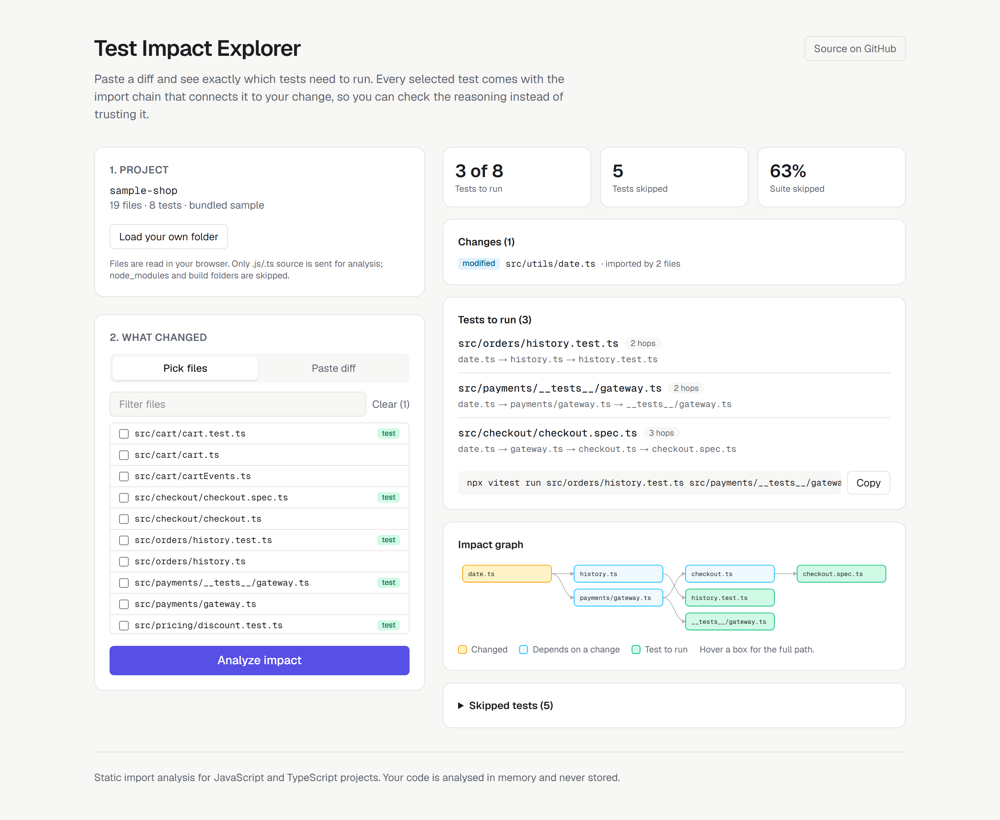

# Test Impact Explorer

Paste a git diff and see exactly which tests need to run. Every selected test comes with
the import chain that connects it to your change, so you can check the reasoning
instead of trusting it.

**Live demo: [test-impact-explorer.vercel.app](https://test-impact-explorer.vercel.app)**. Click an example to see it work.



## Why

Most CI pipelines run the whole test suite on every change. For a JavaScript or
TypeScript codebase you can do better with static analysis: build the import graph,
walk it backwards from the files you touched, and run only the tests that can reach
them. Changing `src/utils/date.ts` in the bundled sample project needs 3 of its 8
tests, and the tool shows why each of those 3 was picked:

```
date.ts → payments/gateway.ts → checkout.ts → checkout.spec.ts   (3 hops)
```

## Features

- **Takes changes in any form:** a `git diff`, `git diff --name-status main`, or a
  plain list of paths. Handles added, deleted and renamed files.
- **Handles real-world imports:** ES modules, `export … from` barrels, dynamic
  `import()`, CommonJS `require`, `@/` path aliases, extension-less imports,
  `index` files, and TS ESM-style `./file.js` imports that point at `file.ts`.
- **Deleted files still count:** files that still import a deleted module are
  reported as affected, because they're exactly what the deletion breaks.
- **Explains each result:** the shortest import chain to every test, the distance
  in hops, and an impact graph.
- **Works on your own repo:** load a project folder in the browser.
  `node_modules`, build output and large files are skipped.
- **Gives you the command:** a ready-to-copy `npx vitest run …` for the selected tests.
- **Has an HTTP API:** `POST /api/analyze` for scripts and CI.

## How it works

1. **Parse.** Strip comments, then collect every module specifier in each file
   (`src/lib/impact/parseImports.ts`).
2. **Resolve.** Turn specifiers into project files using bundler-style rules:
   relative paths, aliases, extension guessing, `index` files and `.js` to `.ts`
   (`resolve.ts`). Package imports are external and ignored.
3. **Build the graph.** Record who imports whom in both directions, plus local imports
   that point at missing files (`graph.ts`).
4. **Walk backwards.** A breadth-first search from each changed file over the
   "imported by" edges. BFS finds the shortest chain to each test first; cycles are
   safe because each file is visited once (`impact.ts`).

The analysis is pure TypeScript with no Node or DOM APIs, so the same code runs in the
API route, the browser and the unit tests.

### Limits

It's static analysis, so it can't see dependencies that don't appear as imports:
- `import(\`./locales/${lang}\`)` and other computed paths
- files read at runtime (fixtures, JSON loaded with `fs`)
- global setup files, and tsconfig `paths` beyond simple prefix aliases

A real CI integration should still run the full suite on `main`.

## API

```bash
curl -X POST http://localhost:3000/api/analyze \
  -H "content-type: application/json" \
  -d '{
    "files": {
      "src/a.ts": "export const a = 1;",
      "src/b.ts": "import { a } from \"./a\"; export const b = a;",
      "src/b.test.ts": "import { b } from \"./b\";"
    },
    "changes": "M\tsrc/a.ts"
  }'
```

The response has `summary` (counts and the % of the suite skipped), `affectedTests`
(each with `distance`, `chain` and `triggeredBy`), `skippedTests`, `impactedFiles`,
`changes`, `notFound`, `graph` and `warnings`. Invalid input gets a `400` with a
message saying what to fix. The full contract is in
[`specs/003-impact-api.md`](specs/003-impact-api.md).

## Running locally

Requires Node.js 20.9 or newer.

```bash
npm install
npm run dev            # http://localhost:3000
```

| Script | What it does |
| --- | --- |
| `npm run check` | Lint, typecheck and unit tests |
| `npm test` | 60 Vitest unit tests for the analyzer |
| `npm run build && npm run test:e2e` | Playwright end-to-end tests on desktop and mobile viewports |

CI runs all of these on every push and pull request
([`.github/workflows/ci.yml`](.github/workflows/ci.yml)).

The same e2e suite can check a deployed site:

```bash
BASE_URL=https://test-impact-explorer.vercel.app npx playwright test
```

## Deploying

### Vercel (live demo)
The live demo runs on Vercel's free Hobby plan. Vercel detects Next.js automatically,
and the app needs no environment variables. Deploy with `vercel deploy --prod`, or
import the repo at [vercel.com/new](https://vercel.com/new) to deploy on every push.

### Azure Static Web Apps
The repo also includes a workflow that deploys `main` to Azure and gives each pull
request its own preview URL.

1. In the Azure portal, create a **Static Web App** on the free plan. Choose
   "Other" as the deployment source.
2. Copy its **deployment token** (Overview → Manage deployment token).
3. In this GitHub repo, add it as an Actions secret named
   `AZURE_STATIC_WEB_APPS_API_TOKEN`.
4. Push to `main`. The workflow builds the app, and Static Web Apps runs the API route
   as a managed function.

Until the secret exists, the deploy workflow skips itself instead of failing.

## Project structure

```
src/
  app/                 Next.js App Router: page, layout, /api/analyze route
  components/          Explorer (state), Results, ImpactGraph (SVG)
  lib/impact/          The analyzer: parse → resolve → graph → impact (+ unit tests)
  lib/sample/          The bundled demo project
specs/                 One spec per feature, with acceptance criteria
e2e/                   Playwright tests and a fixture repo for the folder upload test
docs/                  Screenshots and the agent log
```

## How this was built

This project was built AI-native: each feature started as a spec in [`specs/`](specs/)
with acceptance criteria and test cases, then was implemented by directing a coding
agent (Claude Code), and was then reviewed, tested and screenshot-checked before
moving on.

- [`AGENTS.md`](AGENTS.md) holds the instructions every coding agent gets: commands,
  architecture rules, the definition of done and known traps.
- [`docs/agent-log.md`](docs/agent-log.md) lists the real problems that came up
  during the build and how each was caught. Some were caught by tests, some by reading
  a failure carefully, and some only by looking at screenshots while every test was
  green.

## License

MIT
